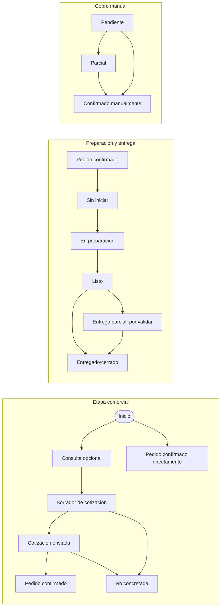

# Alcance adaptable propuesto

**Estado:** punto de partida para conversar y prototipar; no es un MVP aprobado.

## Flujo hipotético a validar

Como hipótesis, el flujo se modela con tres dimensiones relacionadas, pero registradas por separado:

Simplificar estados si los comercios no necesitan distinguirlos. Los nombres y transiciones deben contrastarse con tiendas reales. La aplicación no procesa ni verifica pagos.

## Núcleo común candidato

1. Registrar una consulta/cotización y convertirla en pedido cuando el comercio lo decida.
2. Registrar uno o más productos, variantes relevantes y sus cantidades.
3. Seguir por separado etapa comercial y preparación/entrega.
4. Registrar manualmente el cobro pendiente, parcial o confirmado; decidir después si devolución/refund necesita un flujo separado.
5. Mostrar pendientes y próximos pasos para el personal autorizado.

## Ajustes de configuración candidatos

- nombre, zona horaria y datos del negocio;
- categorías y atributos de productos relevantes para su rubro;
- etiquetas y secuencia de estados dentro de límites definidos;
- medios de cobro que el negocio acepta, sin conectar cuentas financieras;
- roles básicos de propietario y personal.

## Regla para evitar personalización excesiva

Primero resolver variaciones con presets y opciones sencillas. Si un comercio necesita un flujo completamente diferente, registrarlo como señal para evaluar el segmento; no prometer código exclusivo de inmediato.

## Requisitos que se deben diseñar antes de producción

- aislamiento estricto de datos entre negocios;
- permisos por usuario y trazabilidad de cambios;
- exportación, respaldo y borrado de registros;
- controles para que errores de configuración no expongan información de otro comercio.

La multitenencia puede reducir costos operativos compartiendo componentes, pero aumenta las exigencias de aislamiento y autorización. No elegir una arquitectura de base de datos antes de definir el riesgo y el despliegue esperado.
