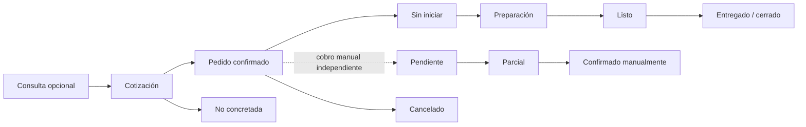

# Product brief | Control de pedidos y cobros

- **Estado:** borrador conceptual; todavía no hay clientes ni entrevistas.
- **Modelo de entrega propuesto:** software como servicio (SaaS), alojado y mantenido por BYTE-CX, con acceso por suscripción recurrente.
- **Público inicial hipotético:** comercios pequeños que venden productos y gestionan consultas, cotizaciones, pedidos, entregas y cobros. Las tiendas de tecnología son el primer contexto para explorar.

## Visión

Una aplicación web que ayuda a un comercio a ver qué consultas, cotizaciones o pedidos requieren atención, cómo avanzan su preparación/entrega y si el negocio anotó manualmente el cobro.

El mismo producto serviría a varios comercios mediante un flujo común y opciones de configuración. No se plantea desarrollar una aplicación distinta para cada comprador.

## Problema y resultado esperado

**Hipótesis:** la información repartida entre conversaciones, hojas y registros puede hacer más difícil seguir pedidos y dar seguimiento a cobros.

**Resultado a validar:** que la persona responsable pueda encontrar rápidamente pendientes, actualizar su estado y dar seguimiento sin duplicar registros. No hay todavía evidencia de que esto sea un problema frecuente ni de que una aplicación lo resuelva mejor que las alternativas actuales.

## Flujo común hipotético

Este flujo sirve para pensar en una aplicación adaptable; los nombres y pasos deberán contrastarse con comercios reales. Como hipótesis de diseño, el seguimiento se registra en tres dimensiones separadas: etapa comercial, preparación/entrega y cobro. Están relacionadas —por ejemplo, la preparación empieza después de confirmar un pedido—, pero una actualización en una dimensión no debe cambiar automáticamente las otras. Esta separación se inspira en patrones documentados de herramientas internacionales; no es todavía evidencia de necesidades locales.

«No concretada», cancelación, entrega parcial, estados predeterminados y reglas para permitir una entrega con saldo pendiente siguen por validar. El flujo no procesa ni verifica cobros.

## Usuarios hipotéticos

- **Propietario o encargado:** configura el negocio, revisa pendientes y da seguimiento.
- **Personal de ventas/atención:** registra consultas, cotizaciones y pedidos, y actualiza su estado.

Estos roles sirven para pensar en permisos y pantallas; todavía no se han observado en un comercio concreto.

## Suscripción: hipótesis comercial

El cliente no compraría la propiedad del software. BYTE-CX mantendría el servicio y cada negocio pagaría por seguir accediendo a él. Una primera hipótesis sencilla es una tarifa recurrente por negocio o local; más adelante se puede comprobar si conviene cobrar por sucursal, usuarios o niveles de servicio.

No se define precio, plan gratuito, prueba de duración ni periodicidad anual hasta conocer el valor recurrente, los costos de soporte/infraestructura y cómo compra el segmento. Stripe documenta opciones como tarifa fija, por usuario, por niveles y por uso; son patrones posibles, no una recomendación automática para BYTE-CX. ([Modelos de precios recurrentes](https://docs.stripe.com/billing/subscriptions/metered-billing/thresholds))

El ingreso dependería de que el comercio renueve; los costos incluyen alojamiento, atención, mantenimiento, incorporación y adquisición de clientes. Más adelante habrá que medir uso recurrente, renovación/cancelación y costo de servir cada cuenta antes de llamar rentable al modelo.

## Adaptabilidad propuesta

El producto tendría un núcleo candidato —registro comercial, líneas de producto, preparación/entrega y estado de cobro separados, responsable e historial— y permitiría configurar datos de cada comercio, como categorías, variantes y métodos de cobro aceptados. La cantidad de estados configurables queda por validar.

La configuración debe cubrir diferencias normales sin convertir cada alta en un proyecto de desarrollo a medida. El primer preset podría orientarse a tiendas de tecnología. Añadir otros rubros dependerá de descubrir un flujo central que realmente se repita.

## Fuera del alcance inicial

- procesar transferencias, custodiar dinero o verificar pagos conectándose a una cuenta bancaria;
- ERP, contabilidad, facturación fiscal o sistema completo de inventario;
- marketplace, tienda en línea pública o logística propia;
- campos y flujos arbitrarios ilimitados por cliente;
- precios comerciales decididos a partir de escenarios inventados.

## Decisiones por validar

- qué perfil y tamaño de comercio atender primero;
- si cotización, pedido y pago pertenecen al mismo flujo;
- qué estado mínimo necesita cada usuario;
- qué diferencias se resuelven con configuración y cuáles no;
- quién usa, decide y paga la suscripción;
- qué soporte esperan, con qué frecuencia y a qué costo;
- Bolivia como primer mercado y qué localización adicional tendría valor.

## Nota técnica futura

Si se mantiene el modelo SaaS para negocios, cada comercio probablemente será un “tenant” con usuarios y datos separados. SaaS es una decisión de negocio; multitenencia es una opción arquitectónica. La separación de datos entre clientes será un requisito crítico, y el grado de aislamiento debe elegirse según riesgo y costo. ([Microsoft Learn: SaaS y multitenencia](https://learn.microsoft.com/en-us/azure/architecture/guide/saas-multitenant-solution-architecture/), [modelos de aislamiento](https://learn.microsoft.com/en-us/azure/architecture/guide/multitenant/considerations/tenancy-models))
