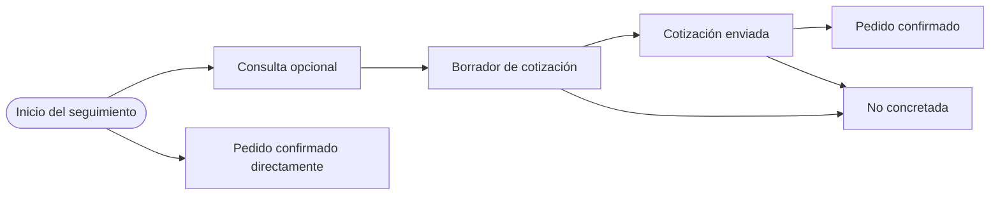
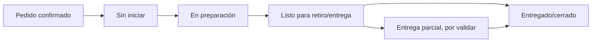
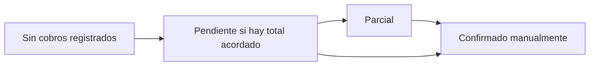

# Mapa piloto | Consulta a cierre del pedido

**Versión:** 0.1 · **Estado:** propuesta para validar, no flujo observado. Referencias consultadas el 25 de septiembre de 2026.

Aplicación inicial del [Ciclo BYTE-CX para diseñar flujos](metodo_diseno_de_flujos.md). Se usa el contexto de comercios que venden periféricos, celulares o componentes de PC. No se ha observado todavía el proceso de ninguna tienda.

La [matriz de estados y transiciones](matriz_de_estados_y_transiciones.md) detalla la propuesta de flujo y sus dudas pendientes.

## 1. Enmarcar

- **Usuario hipotético:** persona que atiende ventas; encargado confirma cobros.
- **Tarea:** dar seguimiento a una solicitud desde la consulta hasta la entrega o cierre.
- **Resultado deseado:** localizar rápidamente qué sigue y registrar los cambios una sola vez.
- **Alcance:** consulta, cotización, pedido, preparación/entrega y anotación manual del cobro.
- **Fuera de alcance:** procesar pagos, confirmar transferencias, inventario en tiempo real, facturación fiscal, ERP y logística propia.

## 2. Evidencia actual

| Etiqueta | Lo que sabemos |
|---|---|
| REFERENTE | Odoo documenta el paso de cotización aceptada a pedido de venta y la continuación hacia entrega, factura y pago. |
| REFERENTE | Shopify presenta por separado los estados de pedido, pago y cumplimiento, y permite filtrar pedidos para encontrar trabajo pendiente. |
| HIPÓTESIS | Un comercio pequeño necesita ver en una misma pantalla tareas operativas y de cobro. |
| HIPÓTESIS | Conviene conservar un mismo registro al convertir la cotización aceptada en pedido. |
| PENDIENTE | No sabemos cómo tiendas bolivianas registran consultas, reservas, anticipos, disponibilidad, entrega parcial, cancelaciones ni seguimiento. |

No hay entrevistas, observaciones ni mediciones de uso. Los tres casos previos (periférico, celular, componentes) son escenarios ficticios para revisar cobertura, no testimonios.

## 3. Proceso actual (AS-IS)

**Desconocido.** No completar este mapa como si fuera la operación real de una tienda. En la primera entrevista, pedir a la persona que describa el último pedido atendido y qué hizo paso a paso, mostrando herramientas o documentos solo si quiere.

El reclutamiento, protocolo y síntesis de esa primera ronda están en [Ronda 01 | Reconstruir el proceso actual](../01_Descubrimiento/ronda_01_mapeo_as_is.md).

Preguntas para levantarlo:

- ¿Qué hace que una consulta merezca seguimiento?
- ¿Dónde registra producto, variante, precio y disponibilidad?
- ¿Qué evento significa que la cotización fue aceptada?
- ¿Quién decide que un pedido está listo o entregado?
- ¿Cómo se confirma un anticipo o saldo y quién lo anota?
- ¿Qué pasa si llega solo parte de los productos o la persona cancela?
- ¿Qué registros usa hoy y qué dato no guardaría en otra herramienta?

## 4. Patrón de referencia y decisión de diseño

| Patrón en documentación pública | Adaptación candidata para BYTE-CX | Qué falta comprobar |
|---|---|---|
| Odoo: cotización aceptada se convierte en pedido de venta. | Mantener el mismo registro y su historial al pasar de cotización a pedido, evitando volver a cargar líneas. | Si en tiendas objetivo la consulta y la cotización se registran juntas o por separado. |
| Shopify: el estado del pedido, pago y cumplimiento son dimensiones distintas. | Presentar seguimiento comercial, preparación/entrega y cobro por separado, de modo que una actualización no oculte otra. | Qué dimensiones y etiquetas necesita realmente una tienda pequeña. |
| Shopify: filtros y vistas ayudan a encontrar órdenes con trabajo pendiente. | Probar una bandeja inicial con búsqueda y filtros por etapa/pendiente. | Cuáles son los filtros que reducen trabajo y qué significa «pendiente» para cada rol. |

## 5. Proceso propuesto (TO-BE) para un caso sencillo

### A. Seguimiento comercial

Una consulta puede pasar directamente a pedido si el comercio no prepara cotización. «Rechazada» y «expirada» son motivos posibles de no concretar; cancelar un pedido confirmado es un resultado distinto. La [matriz](matriz_de_estados_y_transiciones.md) documenta las rutas con más detalle. Validar si el comercio distingue borrador de cotización enviada.

### B. Preparación y entrega

Este carril empieza cuando existe un pedido confirmado. «Entrega parcial» se incluye para comprobarlo, no como requisito decidido. Disponibilidad del producto se trata como una anotación manual aparte, no como sincronización de stock.

### C. Cobro

El cobro puede avanzar en paralelo al pedido. Registrar un cobro no marca automáticamente el pedido como entregado; marcarlo entregado tampoco valida el pago. La política sobre si se puede entregar con saldo pendiente pertenece al negocio y queda pendiente de investigación.

## 6. Tarea de prueba propuesta

> «Una persona consulta por un celular de una variante que no tienes confirmada. Registra lo necesario para retomarlo. Después imagina que confirmaste disponibilidad, enviaste una cotización, la aceptaron, recibiste un anticipo y dejaste el pedido listo para retiro. Muéstrame qué harías y qué revisarías en cada paso.»

Observar si la persona puede distinguir los tres carriles, continuar el registro sin duplicarlo, indicar qué dato necesita y encontrar la siguiente acción. Usar nombres, productos y montos ficticios.

## 7. Riesgos de confusión a revisar

- «Pedido» puede significar solicitud, compra al proveedor o venta al cliente.
- «Cobrado» no equivale necesariamente a «entregado» ni a pago bancario verificado.
- «Disponible» puede referirse a stock propio, disponibilidad del proveedor o una promesa al cliente.
- «Listo» puede significar armado, reservado o esperando retiro.
- Una venta sencilla puede no pasar por una cotización explícita.

## 8. Decisiones actuales y preguntas abiertas

### Decisiones provisionales

- Mantener registro e historial al convertir cotización aceptada en pedido.
- Separar etapa comercial, preparación/entrega y estado de cobro en el modelo conceptual.
- Registrar pagos manualmente; no conectar ni interpretar cuentas bancarias.
- No asumir inventario sincronizado.

### Pendientes antes de congelar los flujos

1. Validar nombres reales y pasos con personas de tiendas de tecnología.
2. Confirmar si la cotización y el pedido se entienden como un registro único o documentos distintos.
3. Comprobar qué casos de pagos parciales y entregas parciales son habituales.
4. Decidir cuáles estados caben en la primera versión y cuáles solo añaden complejidad.

## Fuentes de referencia

- [Odoo 18: Sales quotations](https://www.odoo.com/documentation/18.0/applications/sales/sales/sales_quotations.html)
- [Shopify Help Center: Understanding your order statuses](https://help.shopify.com/en/manual/fulfillment/managing-orders/order-status)
- [Shopify Help Center: Viewing and filtering orders](https://help.shopify.com/en/manual/fulfillment/managing-orders/viewing-orders)
