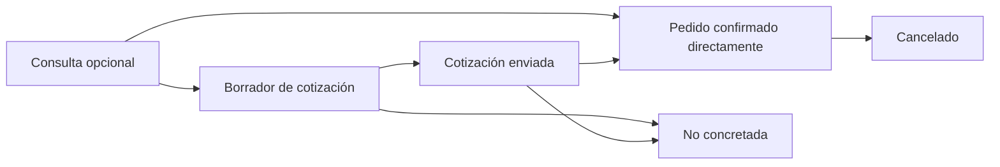
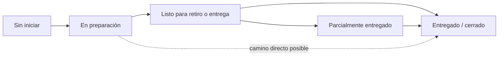
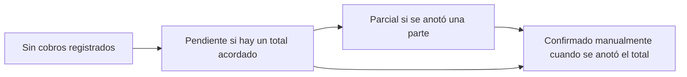

# Matriz de estados y transiciones

**Versión:** 0.1 · **Estado:** propuesta para prototipo, no requisitos aprobados.

Esta matriz hace recorrible el [mapa piloto](mapa_piloto_consulta_a_cierre.md). Se inspira en patrones publicados de Shopify y Odoo, pero todavía debe contrastarse con personas que atienden ventas en comercios de tecnología.

## Vista de las tres dimensiones

### 1. Seguimiento comercial

«Borrador» y «enviada» son estados candidatos para poder saber si falta preparar o dar seguimiento a una cotización. Si las tiendas no distinguen esas actividades, se pueden simplificar en una sola etapa.

### 2. Preparación y entrega

La entrega parcial queda como caso de prueba. El camino directo representa una posible operación donde el negocio no registra cada paso; no implica una regla confirmada.

### 3. Cobro manual

El cobro puede estar pendiente, parcial o confirmado manualmente mientras el pedido se prepara o después de entregarlo. El boceto propone registrar cada monto confirmado y mostrar un estado resumido; no conectar cuentas ni procesar pagos.

Si no existe un total acordado, el sistema no debería inventar un saldo. El estado «No aplica» podría usarse en consultas o registros sin venta, pero falta comprobar si hace falta mostrarlo o basta con dejar el carril vacío.

## Reglas candidatas

| ID | Regla para el prototipo | Por qué | Estado |
|---|---|---|---|
| R1 | Aceptar la cotización conserva productos e historial al crear/confirmar el pedido. | Evita volver a escribir los datos; Odoo documenta esta conversión. | Hipótesis por probar |
| R2 | El pedido confirmado habilita preparación/entrega; cada carril conserva su propio estado. | Los productos de referencia separan pago y cumplimiento; el orden de las tareas debe validarse en comercios. | Hipótesis por probar |
| R3 | Registrar un cobro no cambia la preparación/entrega; cerrar la entrega no confirma el cobro. | Evita que una acción se interprete como prueba de otra. | Decisión de diseño provisional |
| R4 | Los cambios guardan fecha, persona responsable y estado anterior/nuevo en el historial. | Ayuda a reconstruir quién actualizó el registro. | Requisito candidato; alcance por validar |
| R5 | La disponibilidad se anota manualmente y no se presenta como inventario actualizado. | El producto no contempla conexión de stock en esta etapa. | Límite provisional del alcance |
| R6 | Una entrega finalizada puede seguir apareciendo en una vista de cobros pendientes si queda saldo. | La finalización operativa y el cobro son distintos. | Hipótesis por probar |

## Tabla de transiciones candidata

| Dimensión | Desde | Hasta | Evento que lo justificaría | Actor supuesto | Pregunta pendiente |
|---|---|---|---|---|---|
| Comercial | Consulta | Borrador de cotización | El personal comienza a preparar precios/productos. | Atención/ventas | ¿Las consultas se guardan o solo las cotizaciones que merecen seguimiento? |
| Comercial | Borrador | Cotización enviada | Se comparte la propuesta con la persona compradora. | Atención/ventas | ¿Necesitan registrar fecha de envío o próxima fecha de seguimiento? |
| Comercial | Cotización enviada | Pedido confirmado | La persona acepta y el negocio confirma la venta. | Atención/encargado | ¿Qué señal cuenta como aceptación en cada canal? |
| Comercial | Consulta | Pedido confirmado | Venta directa sin cotización formal. | Atención/encargado | ¿Con qué frecuencia pasa? |
| Comercial | Borrador o enviada | No concretada | Se rechaza, expira o se decide no continuar. | Atención/encargado | ¿Se necesitan motivos separados y recordatorio de seguimiento? |
| Comercial | Pedido confirmado | Cancelado | El negocio o comprador cancela la operación. | Atención/encargado | ¿Quién puede cancelar y qué pasa con anticipos o reserva? |
| Preparación/entrega | Sin iniciar | En preparación | El negocio comienza a juntar o pedir productos. | Atención/operaciones | ¿Este paso existe para todos los pedidos? |
| Preparación/entrega | En preparación | Listo | El pedido puede entregarse o retirarse. | Atención/operaciones | ¿Qué quiere decir «listo» para cada comercio? |
| Preparación/entrega | Listo | Entregado/cerrado | El negocio considera completada la entrega. | Atención/operaciones | ¿Quién confirma y qué evidencia necesitan guardar? |
| Cobro | Pendiente | Parcial | Se confirma manualmente un monto menor al total. | Encargado | ¿Se registran varios anticipos y saldos? |
| Cobro | Pendiente o parcial | Confirmado | El encargado anota que recibió el total acordado. | Encargado | ¿Qué hacen con pagos duplicados, corregidos o devueltos? |

## Reglas para corregir un error

- Una corrección no debe borrar silenciosamente el historial.
- Antes de registrar o corregir un cobro, mostrar el monto y el registro asociados para reducir errores.
- La aplicación debe decir «anotado/confirmado por el negocio», no «verificado por el banco».
- No guardar números de cuenta/tarjeta, credenciales ni comprobantes en este flujo.
- Si se cambia un estado por error, registrar la corrección y quién la hizo. Definir la reversión concreta después de conocer permisos y casos reales.

## Escenarios de recorrido

| Caso | Recorrido propuesto | Qué queremos aprender |
|---|---|---|
| Venta directa de periférico | Crear un pedido directo, actualizar su preparación hasta la entrega y registrar el cobro manualmente. | Si consultar/cotizar es opcional y qué pasos realmente se registran. |
| Celular no disponible todavía | Registrar la consulta, cotizar después de verificar disponibilidad, confirmar el pedido, anotar un anticipo y dejarlo listo para retiro. | Cómo se maneja la reserva, qué se promete y cuándo se toma anticipo. |
| Componentes cotizados | Preparar y enviar una cotización; observar si se convierte en pedido o se cierra sin venta. Usar entrega parcial como variante hipotética. | Si los ítems y entregas pueden avanzar por separado y cuándo se cierra la cotización. |

Estos casos siguen siendo escenarios ficticios. Sirven para comprobar que el modelo puede representar distintas rutas; no indican frecuencia de uso.

## Decisiones que debe resolver la investigación

1. ¿Hace falta distinguir borrador, enviada y aceptada, o basta con menos etapas?
2. ¿Puede una venta pasar directamente de consulta a pedido?
3. ¿La persona necesita vencimiento o recordatorio para cotizaciones abiertas?
4. ¿Se prepara/entrega con pago pendiente? ¿Es una política por negocio o una regla del producto?
5. ¿Cuántas veces se dan entregas parciales y cobros parciales en los pedidos típicos?
6. ¿Qué cambios de estado requieren historial o permiso de encargado?

## Uso en la próxima prueba

Pedir a cada participante que recorra un caso reciente y ubique cada acción en las tres columnas: comercial, preparación/entrega y cobro. Si la persona mezcla columnas, usa otros nombres o muestra dependencias diferentes, registrar sus términos y actualizar la matriz antes de cambiar el prototipo.
