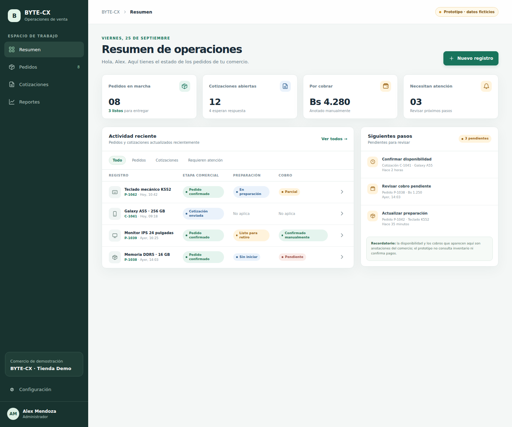

# Prototipo visual local

- **Tipo:** prototipo estático para investigación
- **Estado:** primera propuesta; falta revisarla con comercios.
- **Datos:** completamente ficticios.

## Abrirlo

Desde la raíz del repositorio, ejecuta:

```bash
python3 -m http.server 4173 --directory SDLC/03_Diseno/prototipo_visual
```

Abre `http://localhost:4173` en el navegador y detén el servidor con `Ctrl+C` cuando termines. También puedes abrir `index.html` directamente, aunque el servidor local se parece más al flujo que luego inspeccionará Playwright.



La captura es una vista fija de referencia; `index.html` es la versión navegable actual.

## Pantallas incluidas

- **Resumen:** actividad, indicadores y pedidos recientes.
- **Pedidos:** búsqueda visual, filtros ilustrativos y registros ficticios.
- **Cotizaciones:** propuestas pendientes, enviadas y expiradas.
- **Detalle del pedido:** productos, seguimiento de entrega, cobros anotados e historial.

La navegación cambia de pantalla y el diálogo de “nuevo registro” sirve para revisar el formulario. Ninguna acción conserva cambios, contacta personas, envía cotizaciones o procesa cobros. Es HTML/CSS/JavaScript sin dependencias ni backend.

## Para la próxima revisión

Comparar las etiquetas con las usadas por comercios; observar si encuentran el estado correcto y entienden qué acción sigue; anotar cambios sin tratar los datos de ejemplo como evidencia. Los criterios y el guion están en [`prueba_de_uso.md`](../prueba_de_uso.md).
