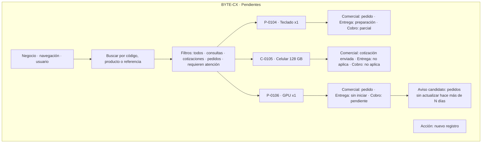
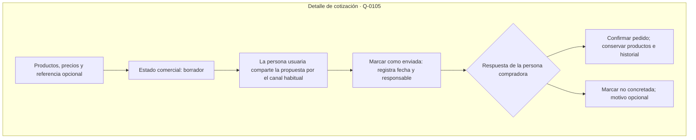
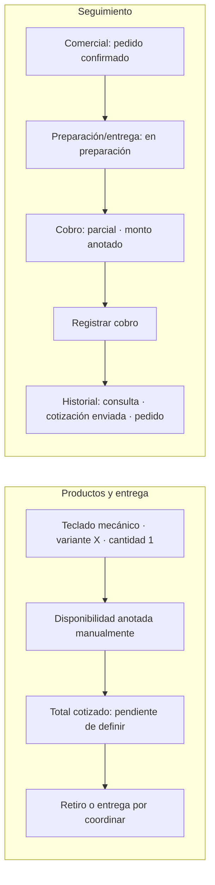

# Esquemas de pantallas y prototipo | Borrador de baja fidelidad

**Estado:** propuesta para discusión; no es interfaz validada. Los datos de ejemplo son ficticios.

Los siguientes esquemas muestran jerarquía y contenido, no distribución visual exacta. Se escriben en Mermaid para mantener diagramas editables; cuando haya que probar espacio, interacción o diseño visual, se pasará a un prototipo navegable.

## Principios que guían estos esquemas

- Primero mostrar qué requiere atención y cuál es el siguiente paso.
- Mantener visibles por separado la etapa comercial, la preparación/entrega y el cobro.
- Permitir comenzar sin importar un catálogo ni conectar inventario.
- Reutilizar el registro al pasar de consulta a cotización y luego a pedido.
- No presentar disponibilidad escrita manualmente como stock en tiempo real.

## Pantalla 1: pendientes y pedidos

La alerta de tiempo y el valor de N son ejemplos; no implementar hasta confirmar que ayuda y definir quién lo configura.

### Adaptación a móvil

En pantalla estrecha, cada registro se presenta como una tarjeta con código/producto, tres estados escritos —comercial, preparación/entrega y cobro— y una acción «Abrir». Los filtros se pueden desplegar para no comprimir la lista.

## Pantalla 2: nueva consulta o cotización

```mermaid
flowchart TB
    subgraph form["Nuevo registro"]
        stage["Etapa inicial: consulta o borrador de cotización"]
        customer["Cliente o referencia: opcional"]
        contact["Contacto de seguimiento: opcional"]
        items["Productos o solicitud: texto libre o catálogo"]
        variant["Variante/atributos: texto libre candidato"]
        availability["Disponibilidad: por confirmar / anotación manual"]
        price["Cantidad y precio propuesto"]
        note["Nota para el equipo; no incluir datos de pago sensibles"]
        owner["Responsable"]
        actions["Guardar consulta · guardar borrador · cancelar"]
        stage --> customer --> contact --> items --> variant --> availability --> price --> note --> owner --> actions
    end
```

Los campos de contacto son opcionales en este boceto porque todavía no sabemos qué dato necesita el comercio para retomar una conversación. El registro podría guardarse con una referencia interna si eso basta para el caso.

### Variantes de producto para tiendas de tecnología

El campo «Variante/atributos» puede contener, por ejemplo, marca, modelo, capacidad, color o compatibilidad. No todos los productos usan los mismos atributos. La propuesta inicial permite texto sencillo; definir atributos estructurados dependerá de entrevistas y del alcance del catálogo.

## Pantalla 2b: dar seguimiento a una cotización

«Marcar como enviada» solo registra que la persona usuaria ya compartió la propuesta por su canal habitual; este boceto no envía mensajes. La separación entre borrador y enviada debe probarse con tiendas.

## Pantalla 3: detalle de pedido

La disponibilidad anotada no se verifica en un sistema de inventario externo. «Registrar cobro» abre un formulario candidato con monto, fecha, método y persona que lo confirmó; no pide datos bancarios ni archivos de comprobantes.

## Datos compartidos y configurables

| Base común candidata | Configuración posible por comercio | Aún por validar |
|---|---|---|
| Código interno, etapas y productos/solicitud, cantidad, responsable e historial | Nombre/imagen del negocio, categorías y lista de productos | Qué campos del cliente hacen falta para dar seguimiento |
| Etapa comercial, preparación/entrega y estado de cobro separados | Atributos por categoría: modelo, variante, capacidad u otros | Si esta separación coincide con el trabajo de tiendas pequeñas |
| Precio propuesto y, si aplica, monto recibido manualmente | Métodos de cobro que el negocio reconoce | Si manejará anticipos y pagos parciales con frecuencia |
| Nota y fecha de creación/actualización | Retiro, entrega u otras opciones de cumplimiento | Si el catálogo debe ser requisito o solo una ayuda opcional |

La configuración no debería permitir reglas arbitrarias ilimitadas en la primera versión. Si cada comercio necesita un flujo radicalmente distinto, el segmento inicial sería demasiado amplio.

## Próxima revisión

Primero reconstruir el proceso actual con personas que atienden pedidos, según la [Ronda 01 de descubrimiento](../01_Descubrimiento/ronda_01_mapeo_as_is.md). Después pedirles que recorran estos esquemas, comparar su vocabulario y corregir el flujo antes de elegir tecnología o construir pantallas reales.
