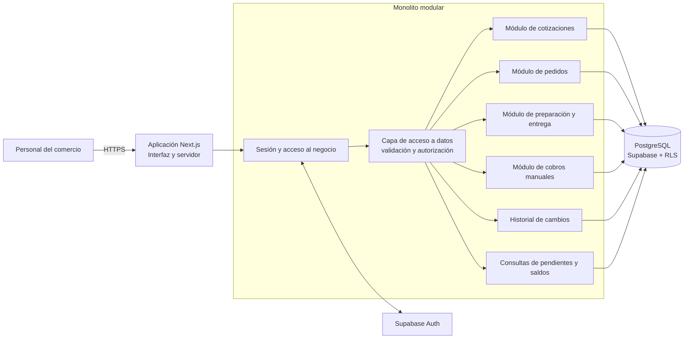
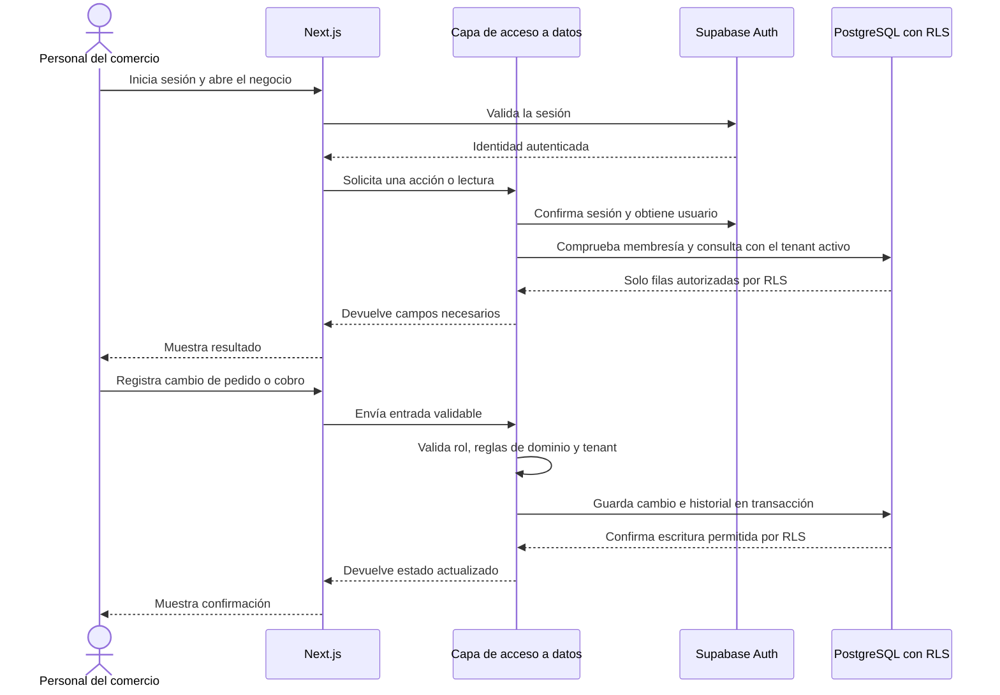

# Arquitectura de referencia | BYTE-CX Control de pedidos y cobros

- **Revisada:** 25 de septiembre de 2026
- **Estado:** propuesta provisional para aprendizaje; no es una especificación aprobada para producción.
- **Contexto de descubrimiento:** tiendas de periféricos, celulares y componentes de PC en Cochabamba, Bolivia. No se han validado procesos con comercios.

## Para qué sirve este documento

Describe cómo podría organizarse una primera versión comercial alojada como SaaS para aprender el ciclo de un producto real: usuarios, negocios, cotizaciones, pedidos, cobros anotados, seguridad, cambios de esquema, despliegues y operación.

La arquitectura no demuestra que exista demanda. Se apoya en una hipótesis: un comercio podría beneficiarse de tener en un solo lugar el seguimiento de cotizaciones, pedidos, preparación/entrega y cobros registrados manualmente.

## Alcance de referencia

La primera versión de aprendizaje tendría un flujo pequeño:

1. Una persona inicia sesión y selecciona un negocio al que pertenece.
2. Registra una cotización o un pedido directo con líneas de producto descritas por texto.
3. Si la cotización se acepta, el sistema crea un pedido conservando el detalle y los precios acordados.
4. El negocio actualiza por separado el estado de preparación/entrega.
5. El negocio anota uno o varios cobros manuales y consulta el saldo calculado.
6. El historial permite ver quién cambió cada registro y cuándo.

El alcance no procesa ni confirma transferencias, no almacena datos de tarjetas o cuentas bancarias, no ofrece un inventario completo, facturación fiscal, contabilidad, marketplace, logística ni suscripciones cobradas automáticamente. Los datos de productos se guardan como descripciones históricas para la cotización o pedido; no prometemos disponibilidad de stock.

## Propuesta de arquitectura

Se propone un **monolito modular**: una aplicación web desplegable como una unidad, dividida en módulos de negocio con límites claros. Para el tamaño inicial y una persona aprendiendo, da una ruta directa desde el mockup a un producto real sin coordinar servicios, colas ni despliegues múltiples.

### Tecnologías de referencia

| Área | Propuesta inicial | Motivo y condición |
|---|---|---|
| Aplicación web y backend | Next.js App Router + TypeScript | Una base de código puede entregar interfaz y lógica del servidor. Usar Server Components para lecturas adecuadas y Server Actions para formularios/mutaciones; proteger cada acción como un punto de entrada público. |
| UI | Tailwind CSS + shadcn/ui | Encaja con el trabajo de prototipos y permite mantener componentes de interfaz editables en el repositorio. No es una obligación del dominio ni impide sustituir la capa visual. |
| Inicio de sesión y datos | Supabase Auth + PostgreSQL | Evita implementar contraseñas y sesiones desde cero; PostgreSQL conserva las relaciones y reglas de integridad. Row Level Security (RLS) se propone como una segunda barrera para separar datos de negocios. |
| Archivos | Ningún almacenamiento de archivos en la primera versión | El flujo no necesita comprobantes ni adjuntos; excluirlos reduce exposición y trabajo de privacidad. |
| Tareas en segundo plano | Ninguna al inicio | No hay envíos automáticos ni procesamiento que requiera una cola. Añadirla solo si aparece una necesidad real. |
| Alojamiento de la aplicación | Pendiente de comparar | Elegirlo al preparar un entorno de prueba, considerando precio vigente, despliegue de Next.js, región, respaldos, restauración, exportación y condiciones aplicables en Bolivia. |

La documentación oficial de Next.js describe App Router, componentes de servidor y acciones del servidor; también indica que una Server Action puede ser invocada mediante solicitudes directas, por lo que debe autenticar y autorizar cada operación. Supabase documenta Auth con clientes SSR y políticas RLS. La selección no fija versiones: se elegirán versiones compatibles y mantenidas al iniciar la construcción. ([Next.js App Router](https://nextjs.org/docs/app), [autenticación de Next.js](https://nextjs.org/docs/app/guides/authentication), [cliente Supabase para Next.js SSR](https://supabase.com/docs/guides/auth/server-side/nextjs), [Supabase RLS](https://supabase.com/docs/guides/database/postgres/row-level-security))

## Contexto y componentes

El diagrama es lógico y no fija cómo se despliegan los proveedores. En una primera entrega, los módulos viven dentro del mismo repositorio y proceso de aplicación; se comunican mediante funciones internas y operaciones de base de datos, no con llamadas de red entre microservicios.

## Recorrido de una operación

El `tenant_id` enviado por el navegador nunca basta para conceder acceso. El servidor debe obtener el usuario de la sesión y verificar su membresía en el negocio. RLS vuelve a limitar las filas a las que se permite acceder. La documentación de Next.js recomienda centralizar autorización en una capa de acceso a datos y hacer comprobaciones en las acciones/handlers; PostgreSQL aplica políticas RLS a filas cuando están habilitadas y configuradas. ([Next.js: autenticación y DAL](https://nextjs.org/docs/app/guides/authentication), [PostgreSQL: RLS](https://www.postgresql.org/docs/18/ddl-rowsecurity.html))

## Límites entre módulos

- **Identidad y negocio:** Supabase autentica a la persona; `business_memberships` decide en qué negocios participa y con qué rol. Una persona podría pertenecer a más de un negocio.
- **Cotizaciones:** conserva líneas, cantidades, precios, moneda y estados de cotización. Aceptar una cotización puede crear un pedido.
- **Pedidos:** mantiene el pedido confirmado y el registro histórico de cada línea. Cada línea guarda una descripción y precio acordados aunque cambie el catálogo futuro.
- **Preparación/entrega:** cambia el estado de cumplimiento sin marcar el pedido como cobrado.
- **Cobros:** registra cobros anotados manualmente. El saldo se calcula desde total menos cobros válidos; no se valida contra banco o proveedor de pago.
- **Historial:** registra actor, hora, entidad y tipo de cambio sin duplicar contraseñas, comprobantes ni datos financieros sensibles.
- **Reportes:** obtiene listas de atención, pedidos abiertos y saldos desde los módulos existentes. No mantiene una segunda copia de registros en la primera versión.

## Separación de datos por negocio

Para el primer SaaS se propone una base PostgreSQL compartida con tablas compartidas y `business_id` (tenant) en cada registro de negocio. Es un patrón de costo operativo menor para comenzar, pero un error de consulta o política puede exponer datos entre comercios.

Controles requeridos antes de usar datos reales:

1. Las consultas de negocio pasan por una capa de acceso que resuelve la membresía activa desde la sesión.
2. Las tablas expuestas aplican permisos mínimos y políticas RLS explícitas; cada política se revisa para lectura y escritura.
3. Las relaciones entre registros incluyen el mismo `business_id` para impedir referencias cruzadas entre tenants.
4. Las acciones del servidor validan sesión, membresía, rol, forma de entrada y transición de estado.
5. Las claves secretas que omiten RLS no se incluyen en el navegador ni en la ruta normal de solicitudes.
6. Se preparan pruebas automatizadas de acceso permitido y denegado entre dos negocios sintéticos antes de cualquier piloto.

Supabase advierte que una clave de servicio puede omitir RLS y debe mantenerse del lado servidor; PostgreSQL usa denegación predeterminada cuando RLS está habilitada y no hay una política que permita la fila. ([Supabase RLS y claves](https://supabase.com/docs/guides/database/postgres/row-level-security), [PostgreSQL RLS](https://www.postgresql.org/docs/18/ddl-rowsecurity.html))

## Entornos y operación previstos

| Entorno | Uso | Datos |
|---|---|---|
| Local | Aprender y desarrollar en una máquina | Semillas sintéticas; secretos locales fuera de Git |
| Prueba | Revisar cambios de interfaz, reglas y separación de negocios | Solo datos sintéticos |
| Producción | Servicio para comercios, solo después de una decisión de lanzamiento | Datos reales mínimos, políticas de privacidad y operación definidas |

Antes de producción habrá que escoger alojamiento, dominio, respaldo y supervisión; automatizar migraciones; probar restauración; definir cómo exportar/eliminar datos; y acordar un procedimiento de incidentes. Nada de eso queda resuelto por este diagrama.

## Secuencia de aprendizaje sugerida

1. **Fundamentos:** estructura de repositorio, TypeScript, formularios, componentes y variables de entorno.
2. **Datos:** esquema/migraciones, llaves foráneas, restricciones e historial básico.
3. **Identidad:** sesión y membresía de negocio.
4. **Seguridad multi-tenant:** autorización en la capa de datos y RLS; comprobar lecturas y escrituras cruzadas.
5. **Primer flujo vertical:** registrar un pedido sintético y consultar su estado.
6. **Completar flujo:** cotización a pedido, preparación/entrega y cobros parciales manuales.
7. **Operación:** datos de prueba, despliegue de prueba, logs, respaldo y restauración.
8. **Validación comercial:** observar flujos AS-IS en tiendas de Cochabamba; ajustar o detener la hipótesis según la evidencia.

## Pendientes antes de implementación comercial

- Confirmar con tiendas si cotizaciones y pedidos se siguen fuera del POS y qué parte causa trabajo concreto.
- Confirmar el usuario principal, roles y si un comercio requiere una o varias sucursales.
- Determinar si se necesita guardar datos de contacto del comprador o basta una referencia mínima.
- Probar si las tres dimensiones separadas (venta, preparación, cobro) representan el flujo real.
- Comparar alojamiento, precios vigentes, región de datos, respaldo y opciones de exportación.
- Revisar obligaciones contractuales, privacidad y facturación aplicables antes de vender una suscripción; este documento no es asesoría legal ni fiscal.
