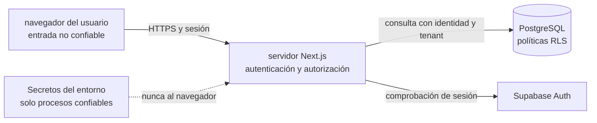

# Seguridad y privacidad | Diseño inicial

**Estado:** requisitos de diseño para una arquitectura de referencia; no acreditan que exista una implementación segura.

## Riesgo principal

Al ser un SaaS multi-tenant, el mayor riesgo funcional inicial es que una cuenta lea o cambie pedidos, cobros o clientes de otro negocio. Este riesgo debe guiar el modelo de datos, la capa de acceso y la verificación previa a cualquier piloto.

## Límites de confianza

## Controles mínimos previstos

### Identidad y permisos

- Usar proveedor de autenticación mantenido; no crear almacenamiento propio de contraseñas como ejercicio del MVP.
- Autorizar cada lectura y mutación según membresía en el negocio y rol actual. Ocultar un botón en la interfaz no es control de acceso.
- Validar la sesión en la capa de acceso a datos y en cada Server Action/Route Handler que realice operaciones protegidas.
- Resolver el negocio activo desde una membresía verificada; no confiar en el `business_id` que envía el navegador.
- Definir roles mínimos: `owner` administra negocio y miembros; `manager` gestiona operación; `seller` registra cotizaciones/pedidos/cobros permitidos. Los permisos exactos se validan con usuarios.

Next.js aconseja centralizar autorización en una capa de acceso a datos y tratar sus acciones del servidor como rutas públicas que requieren sus propias comprobaciones. ([Next.js: autenticación y autorización](https://nextjs.org/docs/app/guides/authentication))

### Aislamiento de tenants

- Cada tabla de negocio lleva `business_id` y sus políticas RLS cubren `SELECT`, `INSERT`, `UPDATE` y `DELETE` según la necesidad.
- Las políticas comprueban membresía activa con el usuario autenticado. Las escrituras verifican también `WITH CHECK` para evitar cambiar el tenant dueño de una fila.
- Aplicar permisos de tabla además de políticas RLS; política no sustituye `GRANT`/privilegios.
- Aplicar restricciones y llaves foráneas compuestas para que relaciones entre pedido, línea, cotización y cobro no crucen de negocio.
- Revisar vistas, funciones, tareas de soporte, exports y consultas administrativas porque podrían exponer datos fuera del camino normal de RLS.
- Nunca usar una clave de servicio que evite RLS en solicitudes normales. Si se necesita para migraciones o soporte, solo en proceso servidor separado y con acceso restringido.
- Antes de cualquier piloto, probar dos negocios sintéticos y comprobar que cada uno solo puede leer/escribir sus propias filas.

La guía de Supabase exige configurar permisos y políticas en tablas expuestas y advierte que la clave de servicio omite RLS; PostgreSQL usa denegación predeterminada cuando no existe política aplicable. ([Supabase RLS](https://supabase.com/docs/guides/database/postgres/row-level-security), [PostgreSQL RLS](https://www.postgresql.org/docs/18/ddl-rowsecurity.html))

### Minimización de datos

- Guardar únicamente los campos que el flujo validado requiera.
- Usar datos sintéticos en desarrollo, documentación y pruebas.
- No recolectar claves bancarias, credenciales, números de tarjeta, comprobantes, IMEI ni número de serie.
- No guardar capturas o exportaciones de conversaciones como parte del flujo inicial.
- El campo de contacto del comprador queda pendiente de validar. Si se incorpora, definir finalidad, quién lo ve, retención y eliminación antes de lanzamiento.
- El historial registra tipo de operación, usuario y hora, evitando copiar notas o valores sensibles innecesarios.

### Secretos, transporte y entradas

- Mantener secretos solo en variables protegidas del servidor o gestor de secretos; no incluirlos en Git ni en bundles del navegador.
- Forzar HTTPS en entornos públicos y configurar cookies de sesión con atributos seguros según el proveedor.
- Validar y normalizar entradas en servidor; imponer límites razonables a texto y tamaño de formulario.
- Limitar intentos de autenticación y proteger acciones públicas contra automatización abusiva antes de producción.
- No registrar tokens, secretos, datos de contacto ni contenido sensible en logs.

### Integridad y trazabilidad

- Guardar pedido, líneas y evento de auditoría en una transacción coherente.
- No eliminar silenciosamente cobros; corregir con reversión o ajuste trazable.
- Registrar quién creó/modificó un pedido y el momento del cambio.
- El estado de preparación no cambia el estado del cobro. El estado de cobro se deriva de entradas registradas.
- Aplicar restricciones de base de datos a relaciones y valores básicos, además de validación de aplicación.

## Respaldo, exportación y eliminación

La selección del proveedor todavía está abierta. Antes de cargar información real hay que documentar:

- periodicidad, retención y cifrado de respaldos;
- quién puede iniciar una restauración y cómo comprobarla;
- cómo exportar datos de un solo negocio sin filtrar a otros;
- cómo borrar o anonimizar información al cerrar una cuenta;
- cómo migrar fuera del proveedor elegido.

No afirmar que existe respaldo recuperable hasta completar una restauración de práctica.

## Riesgos abiertos

| Riesgo | Mitigación de diseño | Pendiente |
|---|---|---|
| Fuga entre negocios | `business_id`, membresía en DAL, RLS, relaciones compuestas | Implementar y demostrar con pruebas automatizadas |
| Usuario no autorizado actualiza estados o cobros | Roles y verificaciones en servidor | Validar permisos con personas que atienden ventas |
| Registro manual no coincide con dinero recibido | Etiquetar como anotación manual y conservar actor/hora | Determinar si hace falta conciliación en otra fase |
| Exposición de datos de compradores | Recopilar mínimo, no adjuntos, controles de acceso y retención | Definir datos de contacto y obligaciones aplicables antes del piloto |
| Pérdida/corrupción | Migraciones, respaldo y restauración probada | Elegir proveedor y fijar objetivo de recuperación |
| Dependencia del proveedor | Mantener PostgreSQL, datos exportables y reglas de negocio fuera de APIs propietarias | Evaluar costos, región y condiciones actuales |

## Puerta mínima antes de datos reales

No habilitar un piloto con información de comercios hasta que exista una decisión de privacidad/retención, autenticación y autorización revisadas, pruebas de aislamiento de tenants, restauración demostrada y un mecanismo de exportación/borrado por negocio.
