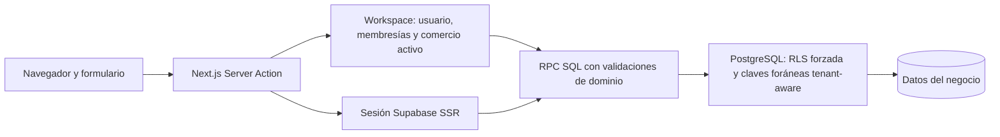

# Estructura del código

La app que continúa el desarrollo vive en `aplicacion/` como monolito modular Next.js. `prototipo_local/` y `../03_Diseno/prototipo_visual/` se conservan como comparadores históricos y no se importan al runtime.

## Módulos

| Ruta | Responsabilidad |
|---|---|
| `aplicacion/src/app/` | Rutas App Router: acceso, comercios, resumen, pedidos, cotizaciones e historial. |
| `aplicacion/src/components/` | Shell, resumen, tablas, estados y editor repetible de líneas. |
| `aplicacion/src/modules/auth/` | Registro/login/logout, creación de comercio y selector de contexto. |
| `aplicacion/src/modules/orders/` | Server Actions con Zod, lectura del dominio, cotizaciones/pedidos/cobros e historial. |
| `aplicacion/src/lib/workspace.ts` | Resuelve sesión, memberships y comercio seleccionado; valida la cookie contra membresías activas. |
| `aplicacion/src/lib/money.ts` | Convierte BOB a centavos/unidades exactas sin `float` para los cálculos monetarios de la app. |
| `aplicacion/src/lib/supabase/` | Tipos del esquema local, cliente Supabase SSR y configuración pública. |
| `aplicacion/src/proxy.ts` | Renueva cookies de sesión Supabase para las rutas Next.js. |
| `aplicacion/supabase/migrations/` | Migraciones versionadas; la migración inicial 0.2 se conserva y 0.3 agrega las operaciones del MVP. |
| `aplicacion/supabase/tests/database/` | pgTAP de aislamiento, integridad, roles, cotizaciones, pedidos y cobros. |
| `aplicacion/supabase/seed.sql` | Dos tenants de desarrollo con datos estáticos sintéticos, sin contraseñas de login. |
| `aplicacion/scripts/e2e-local.mjs` | Prueba Auth/RPC usando dos usuarios temporales sintéticos y clave publishable. |
| `aplicacion/Dockerfile`, `compose.yaml` | Imagen Next.js standalone; Compose conecta la app a la red de Supabase CLI. |
| `aplicacion/prototipo_local/` | Demo anterior HTML/CSS/JS con `localStorage`, separada del runtime. |

## Límites de confianza

Las acciones no autorizan un `business_id` recibido desde el formulario: resuelven el contexto activo en el servidor y la membresía se comprueba otra vez en SQL. Las lecturas usan la sesión del usuario y RLS. Los RPC de escritura verifican actor, negocio, rol y transición; el propietario de funciones es un rol sin login y sin `BYPASSRLS`. El flujo normal no usa `service_role` ni concede DML directo a `authenticated`.

Las relaciones de líneas, pedidos, cobros, reversiones y cotizaciones incluyen `business_id` en claves foráneas compuestas para impedir referencias cruzadas. Las eliminaciones directas están cerradas; cancelar mantiene el registro y deja un evento.

## Reglas del dominio

- Roles: `owner`, `manager`, `seller`. `owner`/`manager` pueden cancelar; los tres roles pueden operar cotizaciones, pedidos, preparación y cobros. No hay pantalla para invitar o cambiar membresías todavía.
- El estado comercial (`confirmed`/`cancelled`) no se combina con preparación (`not_started`/`preparing`/`ready`/`delivered`). El estado financiero se deriva de movimientos vigentes.
- Las cotizaciones guardan líneas snapshot. Aceptación y conversión se realizan en un RPC idempotente que copia precio, cantidad, SKU y descripción.
- Los cobros son apuntes manuales. Revertir agrega un asiento relacionado y opcionalmente conserva un motivo breve; no borra ni modifica el original.
- Tiempos se almacenan como `timestamptz`; la interfaz los presenta en `America/La_Paz`.

El [diseño de arquitectura](../04_Arquitectura_y_seguridad/arquitectura.md) sigue siendo una referencia de aprendizaje más amplia que el código construido. El estado verificable está en [README de la app](aplicacion/README.md) y [registro de cambios](registro_de_cambios.md).
